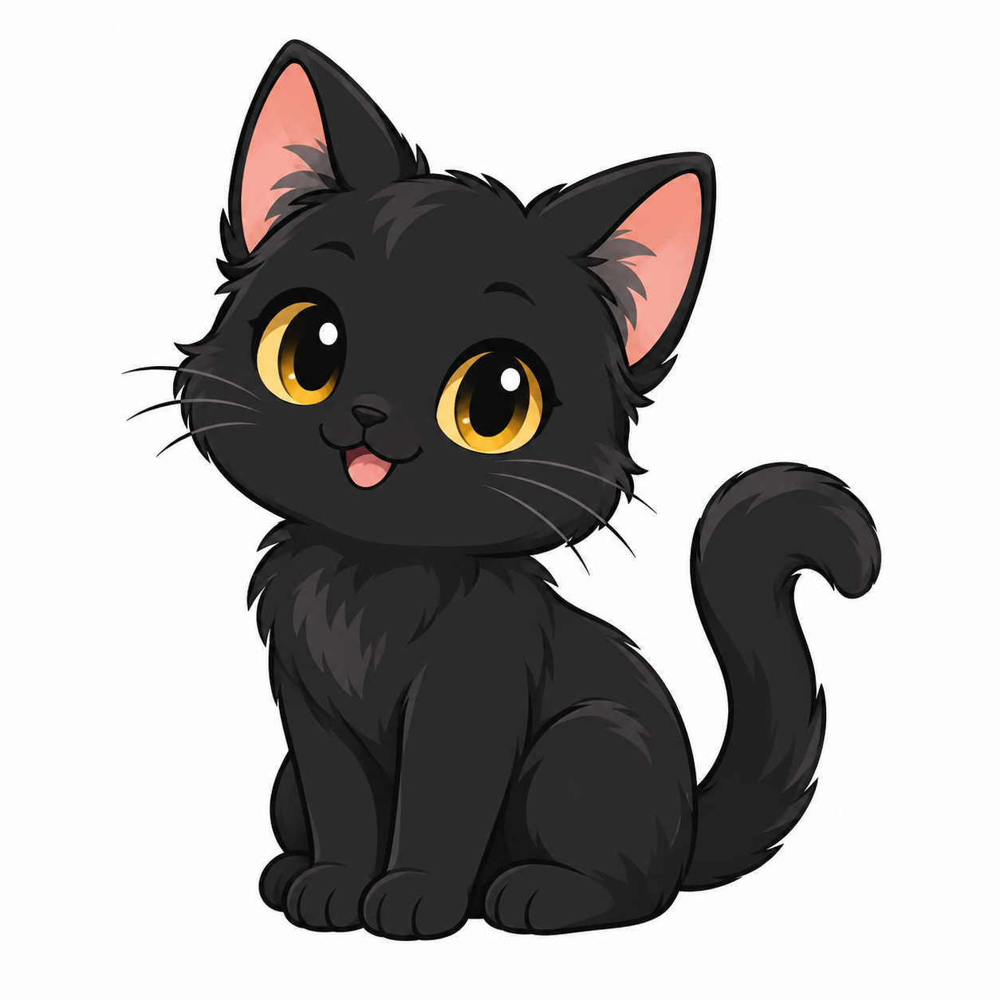
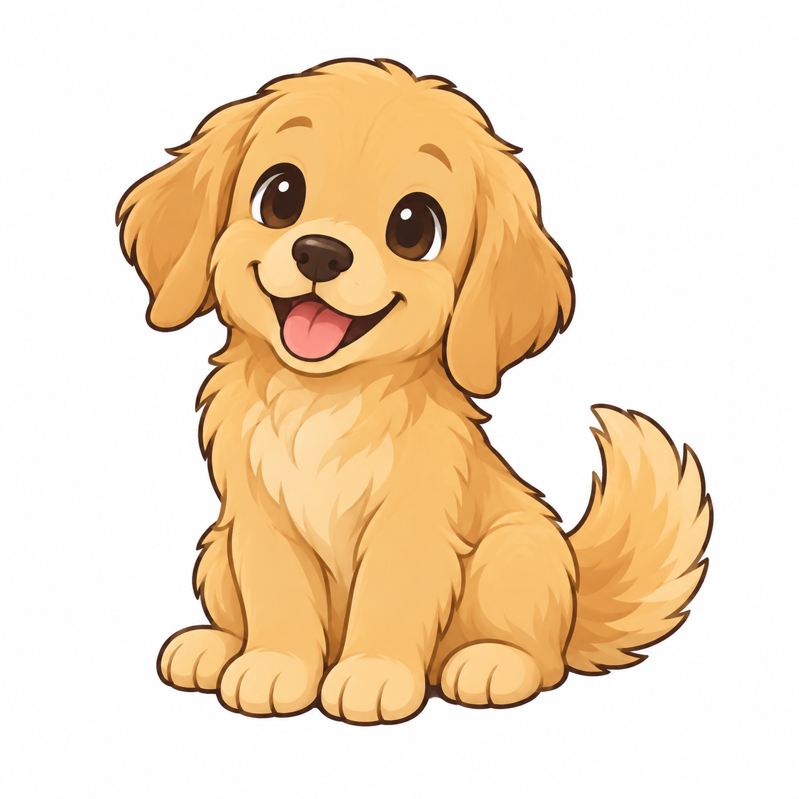
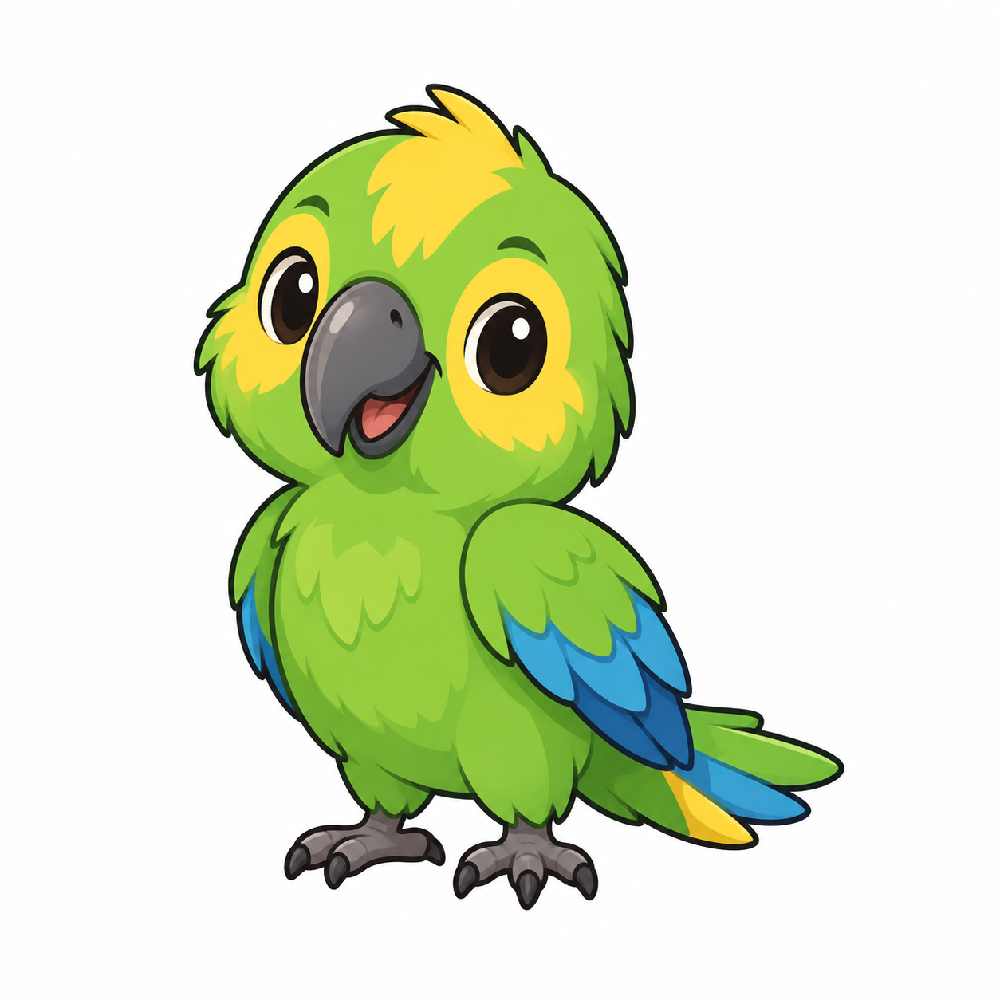
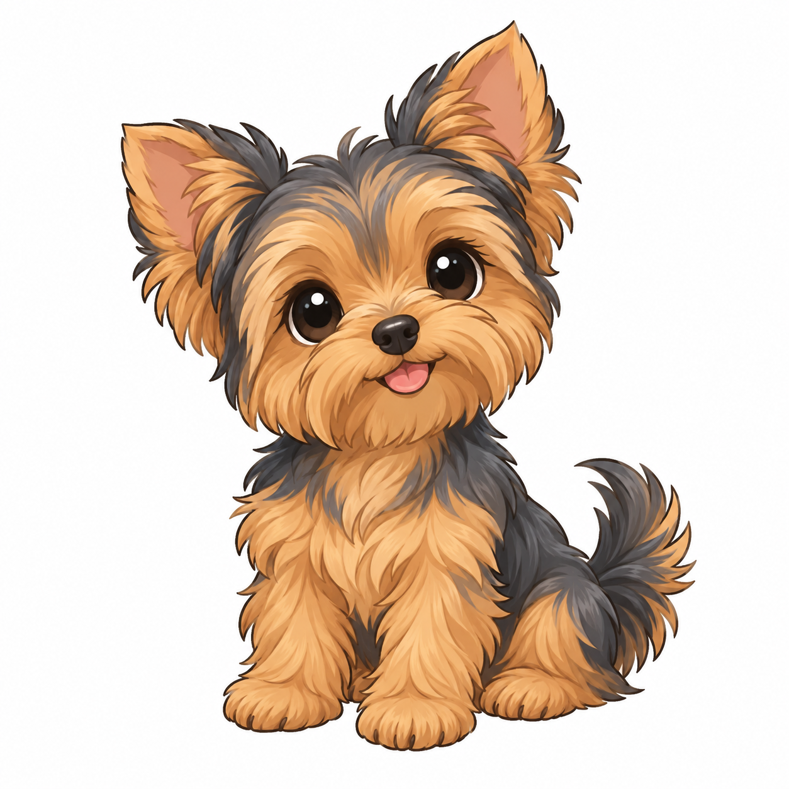

# 🐾 Clips — Mascote do PC

<p align="center">
  Um pequeno companheiro de desktop que acompanha o cursor, reage aos cliques e tira uma soneca quando o computador fica parado.
</p>

<p align="center">
  
  
  
  
  
</p>

O **Clips** é um mascote local feito em Python e PyQt5. Ele fica sobre as janelas, olha na direção do mouse, pode ser arrastado pela tela e oferece opções pela bandeja do sistema.

> Projeto independente e offline: não lê teclas, não captura a tela e não usa a internet.

## ✨ Recursos

- 🐱 Seis mascotes disponíveis: Clippy, Pretí, Marla, Mochi, Louro José e Zoe.
- 🖱️ Acompanha o cursor e reage aos cliques.
- 😴 Entra em modo de descanso após 35 segundos sem movimento do mouse.
- 🖐️ Pode ser arrastado para qualquer lugar da tela.
- ⚙️ Salva o mascote escolhido para a próxima execução.
- 🚀 Permite iniciar automaticamente com o computador.
- 🐧 Funciona no Linux com X11/Xorg e no Windows.

## 📋 Pré-requisitos

- Python 3.9 ou mais recente — confira com `python3 --version` no Linux ou `py --version` no Windows.
- Uma sessão gráfica X11/Xorg no Linux.
- PyQt5, instalado pelos comandos abaixo.

## 🚀 Instalação e execução

### Linux

O programa consulta a posição do cursor usando X11. Em uma sessão Wayland, entre em uma sessão **Xorg** ou **X11** antes de iniciar.

No Ubuntu ou Debian, instale o Python, o suporte a ambientes virtuais e a biblioteca X11:

```bash
sudo apt update
sudo apt install python3 python3-venv libx11-6
```

Na pasta do projeto, crie e ative um ambiente virtual:

```bash
python3 -m venv .venv
source .venv/bin/activate
python -m pip install --upgrade pip
python -m pip install PyQt5
```

Inicie o mascote:

```bash
python mascote.py
```

Para encerrar, clique com o botão direito no mascote e escolha **Sair**, ou pressione `Ctrl+C` no terminal.

> Em outras distribuições, instale os pacotes equivalentes a Python 3, `venv`, `pip` e à biblioteca X11 pelo gerenciador de pacotes da distribuição.

### Windows

1. Instale o Python pelo [site oficial](https://www.python.org/downloads/windows/). Durante a instalação, marque **Add Python to PATH**.
2. Abra o PowerShell na pasta do projeto.
3. Crie e ative um ambiente virtual:

```powershell
py -m venv .venv
.\.venv\Scripts\Activate.ps1
```

4. Instale o PyQt5:

```powershell
python -m pip install --upgrade pip
python -m pip install PyQt5
```

5. Inicie o mascote:

```powershell
python mascote.py
```

Se o PowerShell bloquear a ativação do ambiente virtual, execute uma vez:

```powershell
Set-ExecutionPolicy -Scope CurrentUser RemoteSigned
```

Depois, repita o comando de ativação. Para executar sem manter uma janela do terminal aberta, use:

```powershell
pythonw mascote.py
```

## 🎮 Controles

| Ação | Resultado |
| --- | --- |
| Botão esquerdo + arrastar | Move o mascote pela tela |
| Botão direito | Abre o menu de opções |
| Trocar bichinho | Escolhe outro mascote e salva a preferência |
| Mostrar / esconder | Alterna a visibilidade do personagem |
| Pausar reações | Mantém o mascote parado |
| Iniciar com o computador | Configura ou remove a inicialização automática |
| Ícone na bandeja do sistema | Mostra o mascote novamente depois de escondê-lo |
| Sair | Encerra o programa |

## 🐾 Mascotes

| Nome | Arquivo de referência |
| --- | --- |
| Clippy | Desenhado diretamente no programa |
| Pretí | [`gato-preto.png`](referencias-mascotes/gato-preto.png) |
| Marla | [`cachorro-golden.png`](referencias-mascotes/cachorro-golden.png) |
| Mochi | [`panda.png`](referencias-mascotes/panda.png) |
| Louro José | [`papagaio.png`](referencias-mascotes/papagaio.png) |
| Zoe | [`yorkshire.png`](referencias-mascotes/yorkshire.png) |

As imagens em `referencias-mascotes/` são referências visuais usadas na criação dos desenhos. O programa não precisa carregá-las para funcionar.

## 🛠️ Solução de problemas

### Linux: “A biblioteca X11 não está disponível”

Instale a biblioteca X11 e confirme que está em uma sessão X11/Xorg:

```bash
sudo apt install libx11-6
echo "$XDG_SESSION_TYPE"
```

Se o segundo comando mostrar `wayland`, escolha uma sessão **Xorg** na tela de login e execute novamente.

### Linux: “No module named PyQt5”

Ative o ambiente virtual antes de executar o programa e instale o PyQt5 nele:

```bash
source .venv/bin/activate
python -m pip install PyQt5
```

### Windows: o comando `python` não foi encontrado

Reinstale o Python marcando **Add Python to PATH**, ou use o launcher do Windows:

```powershell
py mascote.py
```

### O mascote parece não abrir

O programa pode já estar em execução. Verifique a bandeja do sistema antes de iniciar outra cópia. O Clips impede automaticamente duas instâncias simultâneas.

## 📁 Estrutura do projeto

```text
.
├── mascote.py
├── referencias-mascotes/
│   ├── cachorro-golden.png
│   ├── gato-preto.png
│   ├── panda.png
│   ├── papagaio.png
│   ├── prompts.md
│   └── yorkshire.png
└── README.md
```

## 📄 Licença

Este projeto é distribuído como software livre sob a **[GNU General Public License v3.0 ou posterior](LICENSE)** (GPL-3.0-or-later).

Você pode usar, estudar, modificar e redistribuir o projeto, desde que respeite os termos da licença. A GPL também garante que versões modificadas e redistribuídas continuem disponíveis sob a mesma licença.
