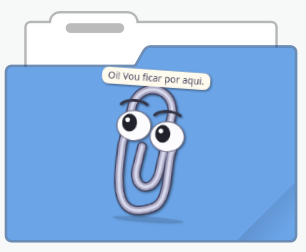

# 🐾 Clips — Mascote do PC

<p align="center">
  Um pequeno companheiro de desktop que reage aos cliques e tira uma soneca quando o computador fica parado.
</p>

<p align="center">
  
</p>

O **Clips** é um mascote local feito em Python e PyQt5. Ele fica sobre as janelas, pode ser arrastado pela tela e oferece opções pela bandeja do sistema. Os personagens desenhados no programa acompanham o mouse com os olhos.

> Projeto independente e offline: não lê teclas, não captura a tela e não usa a internet.

## ✨ Recursos

- 🐱 Oito mascotes disponíveis: Clippy, Pretí, Marla, Mochi, Louro José, Zoe, Mixo e Mixi.
- 🖱️ Os personagens desenhados acompanham o cursor com os olhos; todos reagem aos cliques.
- 😴 Entra em modo de descanso após 35 segundos sem movimento do mouse.
- 🖐️ Pode ser arrastado para qualquer lugar da tela.
- ⚙️ Salva o mascote escolhido para a próxima execução.
- 🚀 Permite iniciar automaticamente com o computador.
- 🐧 Executáveis para Debian/Ubuntu com X11/Xorg e Windows 10/11 de 64 bits.

## 📥 Download — versão 1.0

Os executáveis estão na mesma [release v1.0](https://github.com/leorv/mascotes-desktop/releases/tag/v1.0), com **Python, PyQt5 e as imagens incluídos**. Não é necessário instalar essas dependências para usar o mascote.

| Sistema | Executável | Pacote com README e licença |
| --- | --- | --- |
| Windows 10/11 — 64 bits (x64) | [Baixar .exe](https://github.com/leorv/mascotes-desktop/releases/download/v1.0/clips-1.0-windows-x86_64.exe) | [Baixar .zip](https://github.com/leorv/mascotes-desktop/releases/download/v1.0/clips-1.0-windows-x86_64.zip) |
| Debian 12+ / Ubuntu 22.04+ — 64 bits (amd64/x86_64) | [Baixar executável Linux](https://github.com/leorv/mascotes-desktop/releases/download/v1.0/clips-1.0-linux-x86_64) | [Baixar .tar.gz](https://github.com/leorv/mascotes-desktop/releases/download/v1.0/clips-1.0-linux-x86_64.tar.gz) |

### Windows 10/11

Baixe `clips-1.0-windows-x86_64.exe` e abra com dois cliques. Você também pode extrair o pacote `.zip` e abrir o executável que está dentro dele. O mascote abre sem uma janela de terminal.

### Debian / Ubuntu

O mascote exige uma sessão gráfica **X11/Xorg**; Wayland não é suportado. Na pasta do download, dê permissão de execução e abra o programa:

```bash
chmod +x clips-1.0-linux-x86_64
./clips-1.0-linux-x86_64
```

No pacote `.tar.gz`, o executável já tem permissão de execução. Extraia o pacote antes de abrir o programa.

### Preferências e inicialização automática

Clique com o botão direito no mascote para trocar de personagem, espelhar, pausar ou escolher **Sair**. O menu também está disponível pelo ícone na bandeja do sistema.

Mantenha o executável em uma pasta fixa antes de ativar **Iniciar com o computador**. Se mudar o arquivo de lugar, desative e ative novamente essa opção usando o executável no novo local.

### Conferir a integridade do download

No Linux, baixe [SHA256SUMS](https://github.com/leorv/mascotes-desktop/releases/download/v1.0/SHA256SUMS) na mesma pasta do executável ou do pacote e execute:

```bash
sha256sum --ignore-missing --check SHA256SUMS
```

No Windows, baixe [SHA256SUMS-windows.txt](https://github.com/leorv/mascotes-desktop/releases/download/v1.0/SHA256SUMS-windows.txt) e compare o hash listado para o `.exe` com a saída deste comando no PowerShell:

```powershell
Get-FileHash .\clips-1.0-windows-x86_64.exe -Algorithm SHA256
```

## 🚀 Executar pelo código-fonte

Para desenvolver ou executar o script, use Python 3.9 ou mais recente e PyQt5. Baixe o código do repositório e abra um terminal na pasta do projeto. As imagens em `assets/mixi/` devem acompanhar `mascote.py`.

### Linux

No Ubuntu ou Debian, instale o Python, o suporte a ambientes virtuais e a biblioteca X11:

```bash
sudo apt update
sudo apt install python3 python3-venv libx11-6
```

Crie o ambiente, instale a dependência e execute em uma sessão X11/Xorg:

```bash
python3 -m venv .venv
source .venv/bin/activate
python -m pip install --upgrade pip
python -m pip install PyQt5
python mascote.py
```

Em outras distribuições, instale os pacotes equivalentes pelo gerenciador de pacotes da distribuição.

### Windows

Instale o Python pelo [site oficial](https://www.python.org/downloads/windows/) e execute no PowerShell, na pasta do projeto:

```powershell
py -m venv .venv
.\.venv\Scripts\python.exe -m pip install --upgrade pip
.\.venv\Scripts\python.exe -m pip install PyQt5
.\.venv\Scripts\python.exe mascote.py
```

Para abrir sem manter o terminal, use `.\.venv\Scripts\pythonw.exe mascote.py`.

## 🎮 Controles

| Ação | Resultado |
| --- | --- |
| Botão esquerdo + arrastar | Move o mascote pela tela |
| Botão direito | Abre o menu de opções |
| Trocar bichinho | Escolhe outro mascote e salva a preferência |
| Mostrar / esconder | Alterna a visibilidade do personagem |
| Espelhar mascote | Vira o personagem para o outro lado; a escolha vale para todos e fica salva |
| Pausar reações | Mantém o mascote parado |
| Iniciar com o computador | Configura ou remove a inicialização automática |
| Ícone na bandeja do sistema | Mostra o mascote novamente depois de escondê-lo |
| Sair | Encerra o programa |

## 🐾 Mascotes

| Nome | Arquivo de referência |
| --- | --- |
| Clippy | Desenhado diretamente no programa |
| Pretí | [`gato-preto.png`](referencias-mascotes/gato-preto.png) |
| Marla | [`cachorro-golden.png`](referencias-mascotes/cachorro-golden.png) |
| Mochi | [`panda.png`](referencias-mascotes/panda.png) |
| Louro José | [`papagaio.png`](referencias-mascotes/papagaio.png) |
| Zoe | [`yorkshire.png`](referencias-mascotes/yorkshire.png) |
| Mixo — e.mix | Desenhado diretamente no programa, inspirado no logo da e.mix |
| Mixi — camaleão | [`mixi.png`](referencias-mascotes/mixi.png) |

O **Mixo** preserva o antigo mascote geométrico e suas reações. Quem já o tinha escolhido continua com ele após a atualização.

O **Mixi** é o camaleão da e.mix. Selecione **Trocar bichinho → Mixi — camaleão** para vê-lo em três poses: normal, animado ao clicar e dormindo após 35 segundos sem atividade. Na pose normal, ele pisca e acompanha o mouse com os olhos. A escolha fica salva para a próxima execução.

Ao usar **Espelhar mascote** com o Mixi, o programa usa versões voltadas para o outro lado para manter a escrita **e.Mix** legível no boné e no colete.

As imagens em `referencias-mascotes/` são referências visuais. As dez imagens em `assets/mixi/` são usadas pelo programa e devem acompanhar o arquivo `mascote.py` ao executar pelo código-fonte. No executável da release, elas já estão incluídas.

## 📦 Gerar os executáveis

Os scripts de build incluem as imagens e a licença, executam testes de renderização dos oito mascotes e validam o executável empacotado. Os arquivos são gerados em `dist/`.

### Linux — com Docker

Com Docker instalado, execute na pasta do projeto:

```bash
bash scripts/build-linux.sh
```

O build usa Ubuntu 22.04 e gera o executável, o pacote `.tar.gz` e `SHA256SUMS`. As versões de PyQt5 e PyInstaller estão em [`requirements-build.txt`](requirements-build.txt).

### Windows — com Python 3.11 de 64 bits e Git

No Windows, abra o PowerShell em um checkout Git do projeto e execute:

```powershell
py -3.11 -m venv .venv
Set-ExecutionPolicy -Scope Process Bypass
.\.venv\Scripts\Activate.ps1
.\scripts\build-windows.ps1
```

O script instala as dependências de [`requirements-build-windows.txt`](requirements-build-windows.txt) e gera o `.exe` sem console, o pacote `.zip`, o arquivo de código-fonte e `SHA256SUMS-windows.txt`.

### Builds e validação no GitHub Actions

- [Workflow Linux](.github/workflows/release.yml): compila e testa no Ubuntu 22.04, testa o executável em Debian 12 e Ubuntu 24.04 sem Python instalado e publica a release ao receber a tag `v1.0`.
- [Workflow Windows](.github/workflows/release-windows.yml): compila e testa no Windows Server 2022 e adiciona os arquivos à release `v1.0` existente.

Os testes verificam os oito personagens em 48 combinações de pose e espelhamento, as dez imagens do Mixi e a renderização do executável. Os testes atuais também verificam o ícone da bandeja e a criação e remoção da configuração de inicialização automática. Ainda não houve validação manual em Windows 10/11.

O código do executável Linux publicado corresponde à tag `v1.0`. O Windows inclui os ajustes de empacotamento posteriores; seu commit exato está nas notas da release e o código correspondente está em [`clips-1.0-windows-source.zip`](https://github.com/leorv/mascotes-desktop/releases/download/v1.0/clips-1.0-windows-source.zip).

## 🛠️ Solução de problemas

### Linux: “A biblioteca X11 não está disponível”

Instale a biblioteca X11 e confirme que está em uma sessão X11/Xorg:

```bash
sudo apt install libx11-6
echo "$XDG_SESSION_TYPE"
```

Se o segundo comando mostrar `wayland`, escolha uma sessão **Xorg** na tela de login e execute novamente.

### Linux: “No module named PyQt5”

Ative o ambiente virtual antes de executar o programa e instale o PyQt5 nele:

```bash
source .venv/bin/activate
python -m pip install PyQt5
```

### Windows: o comando `python` não foi encontrado

Ao executar pelo código-fonte, use os comandos com `py` e `.\.venv\Scripts\python.exe` da seção de instalação. Para o executável `.exe` da release, Python não é necessário.

### O mascote parece não abrir

O programa pode já estar em execução. Verifique a bandeja do sistema antes de iniciar outra cópia. O Clips impede automaticamente duas instâncias simultâneas.

## 📁 Estrutura do projeto

```text
.
├── .github/workflows/          # Builds e publicação no GitHub
├── assets/mixi/                # Dez imagens usadas pelo mascote Mixi
├── docs/clips.png              # Imagem de apresentação do README
├── packaging/                  # Ambiente de build Linux e notas da release
├── referencias-mascotes/       # Referências visuais dos personagens
├── scripts/                    # Builds Linux/Windows e testes de renderização
├── mascote.py                  # Aplicativo
├── requirements-build.txt      # Dependências de build Linux
├── requirements-build-windows.txt
├── LICENSE
└── README.md
```

## 📄 Licença

Este projeto é distribuído como software livre sob a **[GNU General Public License v3.0 ou posterior](LICENSE)** (GPL-3.0-or-later).

Você pode usar, estudar, modificar e redistribuir o projeto, desde que respeite os termos da licença. A GPL também garante que versões modificadas e redistribuídas continuem disponíveis sob a mesma licença.
